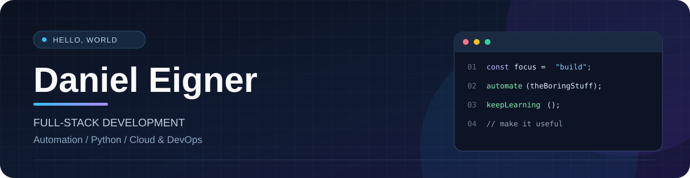

  

  
  
  

## 👋 About me

I'm **Daniel**, a full-stack developer from Germany who enjoys building practical software, exploring new technologies, and making repetitive work a little easier.

My interests span **Python, web development, APIs, automation, DevOps and cloud engineering**. I also enjoy hands-on projects with **Arduino and Raspberry Pi**.

- 🧩 **I like building:** useful tools, integrations, web applications and automation workflows.
- ⚙️ **I enjoy working with:** Python, C++, JavaScript/TypeScript and SQL.
- ☁️ **I explore:** infrastructure, developer tooling, Linux and cloud technologies.
- 🚀 **My approach:** keep learning, build thoughtfully and improve things iteratively.

## ✨ Featured projects

| [📚 SQLTrain](https://github.com/Eige90/SQLtrain) | [💬 WhatsApp Messenger Local](https://github.com/Eige90/whatsapp-messenger) |
| :--- | :--- |
| An interactive SQL learning and practice application. The project roadmap includes an in-browser editor, exercises and a sample database. | A personal, local-first automation tool for scheduled and personalized messages, with recurring schedules and local data storage. |
| **Next.js · TypeScript · React · Tailwind CSS · SQLite WASM** | **JavaScript · SQLite · Chromium · Local automation** |
| [Explore the repository →](https://github.com/Eige90/SQLtrain) | [Explore the repository →](https://github.com/Eige90/whatsapp-messenger) |

## 🧰 Technologies & tools

**Languages**

**Web, back end & data**

**DevOps & infrastructure**

**Hardware & tinkering**

## 📌 Explore more

Check out my [public repositories](https://github.com/Eige90?tab=repositories) for more experiments, tools and projects.

  Build useful things. Keep learning. Make it better.

